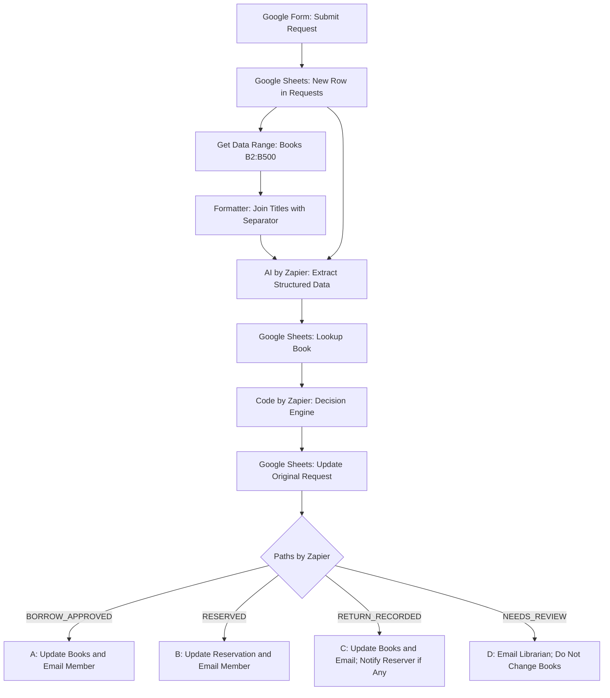

# Library Borrowing & Reservation Tracker

## Process — العملية

يقدّم عضو المكتبة طلب استعارة أو حجز أو إرجاع عبر Google Form. يُسجَّل الطلب في تبويب `Requests`، ثم يقرأ النظام عناوين الكتب مباشرةً من تبويب `Books` في Google Sheets بدل الاعتماد على قائمة ثابتة داخل الـPrompt. يحوّل `Formatter` العناوين إلى نص يُمرَّر إلى `AI by Zapier` لفهم الطلب وتحديد نوعه والعنوان المطابق للكتالوج. بعد ذلك يبحث النظام عن الكتاب، ويطبّق قواعد العمل، ويحدّث الطلب، ويوجّه التنفيذ إلى أحد أربعة مسارات: إعارة، حجز، إرجاع، أو مراجعة بشرية.

**مبدأ النظام:** AI يفهم النص، وRules تتخذ القرار، وHuman يراجع الحالات الاستثنائية.

## Workflow — سير العمل

## Tasks / Subtasks — المهام والمهام الفرعية

| # | Task | Subtasks / المخرجات |
|---|---|---|
| 1 | استقبال الطلب | إرسال Google Form؛ إنشاء صف في `Requests` والحصول على `Row ID` وبيانات العضو ونص الطلب. |
| 2 | قراءة الكتالوج | `Get Data Range` يقرأ `Books!B2:B500`؛ تم ضبطه لإرجاع جميع العناوين، وظهر 308 عناوين في الاختبار. |
| 3 | تجهيز الكتالوج | `Formatter` يجمع العناوين في نص واحد مفصول بعلامة `\|` ويصدره في `Output Text`. |
| 4 | استخراج البيانات | `AI by Zapier` يستقبل `Output Text` ونص الطلب من `COL F` والعنوان من `COL E` في الخطوة 1؛ يحدد `request_type` و`book_title` و`request_summary` و`missing_information`. يعيد عنوان الكتاب بالعربية مطابقًا للشيت، حتى عند ذكره بالإنجليزية. |
| 5 | البحث عن الكتاب | `Lookup Spreadsheet Row` يبحث بالعنوان المستخرج في تبويب `Books`، ويعيد وجود الكتاب وحالته وبيانات الإعارة والحجز. |
| 6 | اتخاذ القرار | `Code by Zapier` يطبّق قواعد التحقق والعمل ويصدر قرارًا واحدًا. يتعامل مع `-` في حقول الحجز على أنها قيمة فارغة. |
| 7 | تسجيل القرار | تحديث الصف الأصلي في `Requests` باستخدام `Row ID`، دون إنشاء طلب مكرر. |
| 8 | التوجيه | `Paths by Zapier` يختار مسارًا واحدًا حسب القرار. |

### المسارات الفرعية

- **A — `BORROW_APPROVED`:** تحديث الكتاب إلى `borrowed`، وتسجيل المستعير وتاريخ الإعارة وموعد الإرجاع بعد 14 يومًا، وإرسال رسالة للعضو.
- **B — `RESERVED`:** تسجيل `reserved_by` و`reserved_email` للعضو الحاجز دون تغيير حالة الكتاب `borrowed`، ثم إرسال تأكيد الحجز.
- **C — `RETURN_RECORDED`:** تسجيل الإرجاع، وتحويل حالة الكتاب إلى `available` إن لم يوجد حجز أو `on_hold` إن وجد؛ إخطار المُرجِع، وإخطار صاحب الحجز إذا كان بريده متاحًا.
- **D — `NEEDS_REVIEW`:** إرسال الطلب وسبب الإحالة إلى أمين المكتبة، دون تعديل سجل الكتاب.

## Sequence — التسلسل

1. يرسل العضو الطلب عبر Google Form.
2. يُضاف صف جديد إلى `Requests`، فيُشغَّل الـZap.
3. تُقرأ العناوين الحالية من `Books!B2:B500`.
4. يحوّل `Formatter` قائمة العناوين إلى `Output Text`.
5. يستقبل AI نص الطلب والعنوان المُدخل والكتالوج الديناميكي؛ يعيد حقولًا منظمة وعنوانًا مطابقًا للشيت.
6. يبحث `Lookup` عن العنوان داخل `Books` ويجلب حالة الكتاب.
7. يتحقق `Decision Engine` من سلامة البيانات وقواعد الإعارة والحجز والإرجاع.
8. يُحفظ القرار في صف الطلب الأصلي.
9. يُنفَّذ مسار واحد من A أو B أو C أو D، مع التحديث والإشعارات المناسبة.

## Dependencies — الاعتماديات

| الخطوة | تعتمد على | لماذا؟ |
|---|---|---|
| New Row | Google Form وربط `Requests` | تشغيل الأتمتة واستلام بيانات الطلب و`Row ID`. |
| Get Data Range | تبويب `Books` وعمود العناوين `B` | الحصول على أحدث قائمة متاحة من الكتب. |
| Formatter | نتيجة Get Data Range | إنشاء `Output Text` الذي يفهمه الـAI كقائمة عناوين. |
| AI by Zapier | `Output Text` + `COL F` + `COL E` من الخطوة 1 | فهم الطلب ومطابقة العنوان بالعربية مع الشيت. |
| Lookup Book | `book_title` المستخرج + تبويب `Books` | العثور على صف الكتاب وحالته الفعلية. |
| Decision Engine | مخرجات AI + Lookup + بيانات العضو | اتخاذ قرار قائم على قواعد محددة. |
| Update Request | `Row ID` + قرار المحرك | تحديث الطلب نفسه دون تكرار. |
| Paths | `decision` | تشغيل مسار واحد مناسب. |
| تحديثات Books والإيميلات | بيانات القرار والكتاب والعضو | تنفيذ الإعارة أو الحجز أو الإرجاع والإشعار. |

## Happy Path — المسار الطبيعي

**مثال اختبار الحجز الناجح:**

1. يرسل العضو `M101` طلبًا يتضمن «العادات الذرية».
2. تُقرأ العناوين الحالية من `Books` وتُمرَّر إلى AI عبر `Formatter`.
3. يُرجع AI نوع الطلب `borrow` والعنوان العربي المطابق «العادات الذرية».
4. تعثر خطوة `Lookup` على الكتاب: `Found = true`، والحالة `borrowed` لدى `M102`.
5. يحدد `Decision Engine` القرار `RESERVED` للعضو `M101`، لأن الكتاب معار ولا يوجد حجز سابق صالح.
6. ينتقل الطلب إلى المسار B لتسجيل الحجز وإرسال رسالة التأكيد.

**حدود التحقق:** نتائج الاختبار التي تم تأكيدها هي نجاح استخراج البيانات والبحث وقرار `RESERVED`؛ لم يُذكر تأكيد نهائي لتنفيذ تحديث الحجز وإرسال البريد في هذه التجربة.

## Exception Path — مسار الاستثناء

| الاستثناء | المعالجة |
|---|---|
| عنوان غير موجود ضمن الكتالوج المقروء | `NOT_IN_CATALOG` ثم `NEEDS_REVIEW` بدل تعديل كتاب غير معروف. |
| عنوان مكتوب بالإنجليزية وله مقابل عربي في الشيت | يحاول AI إرجاع العنوان العربي المطابق من القائمة الديناميكية؛ إن تعذرت المطابقة تُحال الحالة للمراجعة. |
| بيانات العضو أو نوع الطلب أو العنوان ناقصة أو غير واضحة | `NEEDS_REVIEW` مع سبب واضح. |
| أكثر من كتاب في طلب واحد | `MULTIPLE` ثم مراجعة بشرية. |
| الكتاب محجوز لعضو آخر أو العضو يستعير الكتاب نفسه بالفعل | مراجعة بشرية بدل إجراء متعارض. |
| طلب إرجاع لا يطابق المستعير المسجل | مراجعة بشرية دون تغيير حالة الكتاب. |
| لا يوجد حجز عند إرجاع الكتاب | يتحول الكتاب إلى `available`؛ يتوقف فرع إشعار الحاجز بواسطة `Filter`. |
| تعطل قراءة الكتالوج أو تنسيقه | يجب اعتبار ذلك خطأ تكامل يحتاج فحصًا؛ لا يجوز افتراض أن القائمة فارغة أو اتخاذ قرار إعارة بناءً على بيانات ناقصة. |

## التعديل المنفذ وسبب أهميته

**المشكلة السابقة:** كان الـPrompt يحتوي على ثمانية عناوين ثابتة فقط، وبعضها بالإنجليزية بينما أصبحت عناوين `Books` بالعربية؛ لذلك كان AI يعيد `NOT_IN_CATALOG` أو عنوانًا لا تجده خطوة `Lookup`، فتُحال طلبات صحيحة إلى أمين المكتبة.

**التصحيح:** أُضيفت خطوتا `Get Data Range` و`Formatter` قبل AI، واستُبدلت القائمة اليدوية بـ`Output Text`، وأُضيفت قاعدة المطابقة بالعربية، وأُعيد ربط نص الطلب (`COL F`) والعنوان (`COL E`) من الخطوة 1.

**النتيجة:** في الاختبار، استُرجعت 308 عناوين، وتعرّف AI على «العادات الذرية»، ونجح البحث في العثور عليها، وأصدر المحرك قرار `RESERVED`. أصبحت أسماء الكتب تُؤخذ من الشيت عند كل طلب، ضمن نطاق القراءة المحدد `B2:B500`، فلا تحتاج إضافة كتاب داخل هذا النطاق إلى تعديل قائمة يدوية في الـPrompt.
