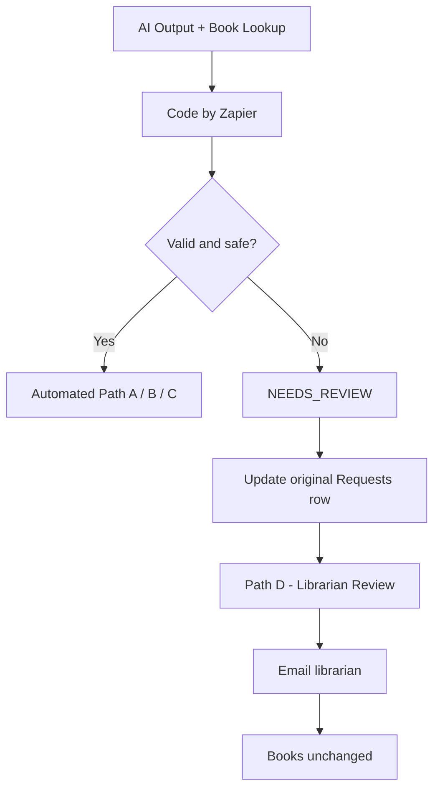

# 04 — AI / Rules / Human & Exceptions

**Project:** Library Borrowing & Reservation Tracker

## 1. AI — أين نستخدم الذكاء الاصطناعي؟

نستخدم `AI by Zapier` لفهم طلبات أعضاء المكتبة المكتوبة باللغة الطبيعية وتحويلها إلى بيانات منظمة.

قبل خطوة AI، يقرأ `Get Data Range` عناوين الكتب من تبويب `Books` في النطاق `B2:B500` (308 عناوين وفق آخر اختبار)، ثم يحولها `Formatter` إلى `Output Text` ليستخدمها البرومبت بدل قائمة الكتب الثمانية الثابتة.

| AI Output | Purpose |
|---|---|
| `request_type` | تحديد `borrow` أو `reserve` أو `return` أو `other` أو `unknown` |
| `book_title` | إرجاع عنوان مطابق للكتالوج، بالعربية كما في الشيت حتى لو كُتب الطلب بالإنجليزية |
| `request_summary` | تلخيص الطلب بلغة العضو |
| `missing_information` | توضيح المعلومات الناقصة أو `None` |

**حدود AI:** لا يخترع أسماء كتب أو تواريخ، ولا يقرر الإعارة أو الحجز، ولا يعدّل حالة الكتاب.

## 2. Rules — أين نستخدم القواعد؟

تعمل `Code by Zapier` بوصفها **Decision Engine**. تستقبل مخرجات AI وبيانات العضو ونتيجة `Lookup Spreadsheet Row` من تبويب `Books`، وتطبق **13 قاعدة مرتبة**؛ أول قاعدة منطبقة تحدد قرارًا واحدًا.

| Condition | Decision |
|---|---|
| الكتاب `available`، أو `on_hold` لنفس العضو، والطلب استعارة/حجز | `BORROW_APPROVED` |
| الكتاب `borrowed` وليس عليه حجز، والطلب استعارة/حجز | `RESERVED` |
| طلب إرجاع من العضو المسجل في `borrowed_by` والكتاب `borrowed` | `RETURN_RECORDED` |
| مخرجات غير صالحة، بيانات ناقصة، تعارض أو طلب خارج القواعد | `NEEDS_REVIEW` |

توجه `Paths by Zapier` القرار إلى مسار واحد: `auto_borrow` أو `auto_reserve` أو `auto_return` أو `librarian_review`.

**قواعد مهمة:** طلب حجز كتاب متاح يتحول إلى إعارة؛ وطلب استعارة كتاب مُعار دون حجز يتحول إلى حجز. لا يوجد أكثر من حجز واحد للكتاب في هذه النسخة. تعامل معالجة القواعد الرمز `-` في حقول الحجز بوصفه قيمة فارغة، كما ظهر في الاختبار المحدّث.

## 3. Human — أين نحتاج التدخل البشري؟

يتدخل **أمين المكتبة** عند تعذر اتخاذ قرار آمن تلقائيًا، مثل الطلبات غير الواضحة، والكتب غير الموجودة، وتعارض سجلات الإعارة والحجز. يتلقى بريدًا يحتوي على بيانات العضو، والنص الأصلي، ومخرجات AI، وسبب المراجعة، وحالة الكتاب.

لا ينفذ مسار المراجعة تعديلًا على `Books`. القرار البشري اللاحق وكيفية تسجيله يدويًا خارج خطوات الأتمتة الموضحة في المرجع.

## 4. Exceptions — الحالات الاستثنائية

| Exception | Trigger | Handling |
|---|---|---|
| Invalid AI Output | مخرجات AI ناقصة أو خارج القيم المسموحة | `NEEDS_REVIEW` |
| Missing Member Data | اسم العضو أو رقم العضوية أو البريد فارغ | `NEEDS_REVIEW` |
| Unknown Request | `request_type = unknown` | `NEEDS_REVIEW` |
| Out-of-Scope Request | `request_type = other` | `NEEDS_REVIEW` |
| Missing Book Title | `book_title = Not provided` | `NEEDS_REVIEW` |
| Multiple Books | `book_title = MULTIPLE` | `NEEDS_REVIEW` |
| Book Not Found | `NOT_IN_CATALOG` أو فشل العثور على الصف | `NEEDS_REVIEW` |
| Already Borrowed by Same Member | العضو يطلب استعارة/حجز كتاب مُعار له بالفعل | `NEEDS_REVIEW` |
| Already Reserved by Another Member | الكتاب محجوز لعضو آخر | `NEEDS_REVIEW` |
| Invalid Return | الإرجاع لا يطابق سجل المستعير أو حالة الكتاب | `NEEDS_REVIEW` |

**ملاحظة:** الحالات أعلاه استثناءات عمل وبيانات. لا يحدد المرجع مسارًا مستقلًا لإعادة المحاولة التلقائية عند فشل خدمات Zapier أو البريد الإلكتروني.

## 5. Exception Handling — ماذا يحدث عند ظهور Exception؟

1. تكتشف `Code by Zapier` الاستثناء وتنتج `decision = NEEDS_REVIEW` و`requires_human = true` وسببًا في `review_reason`.
2. تحدّث خطوة `Update Row` صف الطلب الأصلي في `Requests` باستخدام `Row ID` دون إنشاء صف جديد.
3. يختار `Paths by Zapier` المسار `D — librarian_review`.
4. يرسل `Gmail` تفاصيل الطلب وسبب المراجعة إلى أمين المكتبة.
5. **لا تتغير بيانات الكتاب في `Books`** حتى تتم المراجعة.

## Expected Outcome

| Layer | Responsibility |
|---|---|
| **AI** | فهم النص واستخراج البيانات وفق الكتالوج الديناميكي |
| **Rules** | التحقق من البيانات وتطبيق قرارات قابلة للتدقيق |
| **Human** | معالجة الحالات التي لا يمكن أتمتتها بأمان |

> **Principle:** AI understands → Rules decide → Human reviews exceptions.
