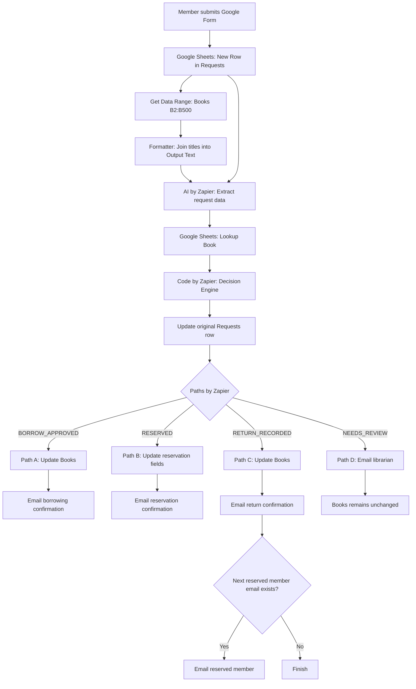

# 05 — Automation Solution Design

**Project:** Library Borrowing & Reservation Tracker

> **Do not start with the tool. Start with the design.**

## 1. Solution Overview

يهدف النظام إلى أتمتة استعارة الكتب وحجزها وإرجاعها. يستقبل Google Forms طلب العضو، ويحفظ Google Sheets الطلب في `Requests`، ثم يُقرأ الكتالوج من `Books` ويُستخدم AI لفهم النص، بينما تتولى القواعد اتخاذ القرار ويعالج أمين المكتبة الاستثناءات.

**Design principle:** AI understands → Rules decide → Human reviews exceptions.

## 2. Final Workflow

## 3. Automation Components

| Component | Tool | Responsibility |
|---|---|---|
| Input | Google Forms | استقبال الطلب |
| Trigger | Google Sheets | اكتشاف صف جديد في `Requests` |
| Catalog Retrieval | Google Sheets — Get Data Range | قراءة العناوين من `Books!B2:B500` |
| Data Formatting | Formatter | تحويل العناوين إلى نص واحد في `Output Text` |
| AI Extraction | AI by Zapier | استخراج نوع الطلب والعنوان والملخص والنواقص |
| Book Lookup | Google Sheets | البحث عن الكتاب وحالته |
| Decision Engine | Code by Zapier | تطبيق 13 قاعدة بالترتيب |
| Logging | Google Sheets | تحديث سجل الطلب الأصلي |
| Routing | Paths by Zapier | اختيار مسار واحد من أربعة |
| Actions | Google Sheets + Gmail | تحديث حالة الكتاب وإرسال البريد |
| Human Review | Librarian | معالجة الاستثناءات |

## 4. Workflow Sequence

| Step | Action | Output |
|---|---|---|
| 1 | New Spreadsheet Row | بيانات العضو، نص الطلب، و`Row ID` |
| 2 | Get Data Range | عناوين الكتب من `B2:B500` |
| 3 | Formatter | قائمة العناوين في `Output Text` |
| 4 | AI by Zapier | `request_type`, `book_title`, `request_summary`, `missing_information` |
| 5 | Lookup Spreadsheet Row | سجل الكتاب وحالته أو عدم العثور عليه |
| 6 | Code by Zapier | القرار وسبب المراجعة وبيانات التحديث |
| 7 | Update Row — Requests | حفظ النتيجة في الصف الأصلي |
| 8 | Paths by Zapier | توجيه الطلب إلى A أو B أو C أو D |

## 5. Final Decision Paths

| Path | Decision | Actions |
|---|---|---|
| A | `BORROW_APPROVED` | تغيير الحالة إلى `borrowed`، تسجيل العضو وتاريخ الإعارة وموعد الإرجاع بعد 14 يومًا، مسح بيانات الحجز، وإرسال تأكيد |
| B | `RESERVED` | إضافة `reserved_by` و`reserved_email` دون تغيير حالة `borrowed`، وإرسال تأكيد الحجز |
| C | `RETURN_RECORDED` | تفريغ بيانات المستعير، تغيير الحالة إلى `available` أو `on_hold` إذا وُجد حجز، تأكيد الإرجاع، ثم إشعار صاحب الحجز عند وجود بريده |
| D | `NEEDS_REVIEW` | إرسال تفاصيل الطلب وسبب الإحالة لأمين المكتبة، دون تعديل `Books` |

## 6. Exceptions & Safeguards

تُحال للمراجعة البشرية حالات المخرجات غير الصالحة، أو نقص بيانات العضو، أو غموض نوع الطلب، أو غياب عنوان الكتاب، أو تعدد الكتب في طلب واحد، أو عدم وجود الكتاب في الكتالوج، أو تعارض الاستعارة والحجز، أو عدم مطابقة الإرجاع لسجل المستعير.

عند ظهور استثناء، يحفظ النظام `NEEDS_REVIEW` وسبب الإحالة في صف `Requests` الأصلي، ثم يرسل إشعارًا إلى أمين المكتبة. لا يُغيّر سجل الكتاب في هذا المسار.

## 7. Design Constraints

- تبويب `Books` يحتوي وفق التحديث الأخير على **308 عناوين**، ويُقرأ ديناميكيًا من النطاق `B2:B500`.
- يطابق AI العنوان مع الكتالوج الحالي، حتى عند اختلاف لغة إدخال العضو، ولا يخترع عنوانًا غير موجود.
- يتخذ `Code by Zapier` القرار وفق **13 قاعدة مرتبة**؛ لا يتخذ AI قرار الإعارة بنفسه.
- يُحدَّث صف `Requests` الأصلي باستخدام `Row ID` قبل التفرع.
- المسارات الأربعة متنافية، ولا يُنفذ سوى المسار الموافق للقرار.
- تسمح النسخة الحالية بحجز واحد فقط لكل كتاب، ولا تدعم طابور انتظار.
- قراءة `B2:B500` لا تشمل الكتب التي تُضاف خارج هذا النطاق ما لم يُوسَّع.

## 8. Expected Outcome

مخطط واضح وقابل للتنفيذ من تقديم الطلب حتى تحديث السجلات والإشعارات أو الإحالة البشرية، مع فصل مسؤوليات AI والقواعد والإنسان والحفاظ على سلامة بيانات المكتبة.

**Verification note:** أظهر الاختبار المحدّث نجاح استخراج عنوان «العادات الذرية»، والعثور عليه في `Books`، واتخاذ قرار `RESERVED`؛ ولا يكفي هذا الاختبار وحده لإثبات نجاح تحديث الحجز وإرسال البريد في التشغيل الكامل.
