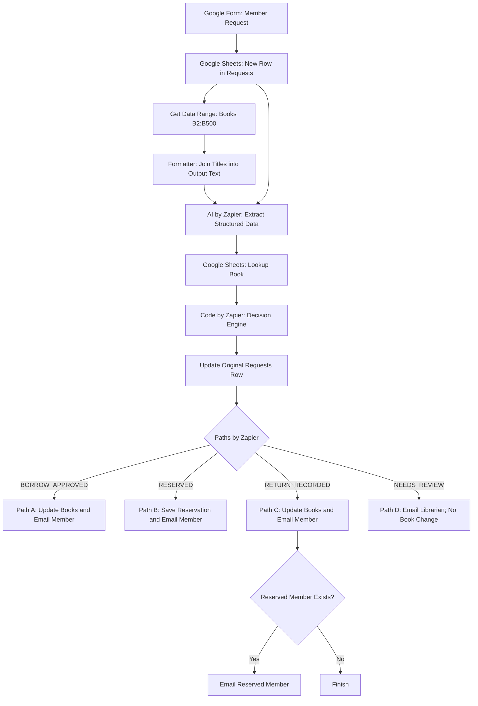

# Library Borrowing & Reservation Tracker

> **AI Automation Project | Google Forms · Google Sheets · Zapier · AI by Zapier · Gmail**

## Project Overview

نظام أتمتة لإدارة طلبات **استعارة الكتب وحجزها وإرجاعها** في المكتبة. يرسل العضو طلبه بلغة طبيعية عبر Google Forms، فيفهمه الذكاء الاصطناعي، ثم تتحقق قواعد النظام من حالة الكتاب وتتخذ القرار المناسب. تُحدَّث السجلات ويُرسل إشعار بالبريد الإلكتروني، أو يُحال الطلب إلى أمين المكتبة عند وجود مشكلة.

**مبدأ العمل:** AI يفهم النص، وRules تتخذ القرار، وHuman يراجع الاستثناءات.

## 01 — Business Analysis

### المشكلة

تتطلب متابعة طلبات الاستعارة والحجز والإرجاع يدويًا وقتًا وجهدًا، وقد تتسبب في تأخر الردود أو عدم اتساق بيانات الكتب والطلبات.

### العملية قبل الأتمتة

يستقبل مسؤول المكتبة الطلب، ويتحقق من الكتاب وحالته، ثم يحدد إمكانية الاستعارة أو الحجز أو الإرجاع، ويحدّث السجلات ويرد على العضو يدويًا.

### الهدف

تقليل العمل اليدوي وتسريع معالجة الطلبات، مع الاحتفاظ بسجل واضح لكل عملية وعدم إجراء تغييرات غير آمنة على بيانات الكتب.

### Success Criteria

- استقبال الطلب من Google Forms وتسجيله في `Requests`.
- فهم نوع الطلب وعنوان الكتاب باستخدام AI.
- البحث عن الكتاب في `Books` والتحقق من حالته.
- إصدار قرار واحد صحيح وفق قواعد محددة.
- تحديث سجل الطلب الأصلي وسجل الكتاب عند الحاجة.
- إرسال الإشعار المناسب أو إحالة الحالات الاستثنائية لأمين المكتبة.
- اختبار مسارات الاستعارة والحجز والإرجاع والمراجعة البشرية.

## 02 — Process & Workflow

### Process

استقبال الطلب ← قراءة كتالوج الكتب ← استخراج بيانات الطلب ← البحث عن الكتاب ← تطبيق قواعد القرار ← تسجيل النتيجة ← تنفيذ المسار المناسب.

### Final Workflow

### Tasks / Subtasks & Sequence

| # | Task | Output |
|---|---|---|
| 1 | رصد صف طلب جديد في `Requests` | بيانات العضو و`Row ID` |
| 2 | قراءة `Books!B2:B500` | عناوين الكتالوج |
| 3 | دمج العناوين باستخدام Formatter | `Output Text` |
| 4 | تحليل الطلب باستخدام AI | نوع الطلب، عنوان الكتاب، الملخص، النواقص |
| 5 | البحث عن العنوان في `Books` | حالة الكتاب وبيانات الإعارة والحجز |
| 6 | تطبيق القواعد في Code by Zapier | القرار والمسار وسبب المراجعة |
| 7 | تحديث صف الطلب الأصلي | نتيجة محفوظة دون صف مكرر |
| 8 | تشغيل أحد المسارات الأربعة | تحديث مناسب وإشعار أو مراجعة بشرية |

### Dependencies

يعتمد AI على بيانات الطلب وقائمة العناوين الناتجة من Formatter. ويعتمد البحث عن الكتاب على العنوان المطابق الذي يعيده AI. ويعتمد محرك القواعد على مخرجات AI ونتيجة البحث وبيانات العضو. ولا تبدأ إجراءات المسارات إلا بعد حفظ القرار في `Requests`.

### Happy Path / Exception Path

- **Happy Path:** بيانات صحيحة وكتاب بحالة مناسبة ← قرار تلقائي ← تحديث السجلات وإرسال إشعار.
- **Exception Path:** معلومات ناقصة أو تعارض في السجلات ← `NEEDS_REVIEW` ← تسجيل السبب وإرسال الحالة لأمين المكتبة دون تعديل `Books`.

## 03 — Data Design

### Trigger & Inputs

**Trigger:** حدث `New Spreadsheet Row` في تبويب `Requests` بعد إرسال Google Form.

| Input | Purpose |
|---|---|
| `member_name` | اسم العضو |
| `member_id` | رقم العضوية |
| `email` | البريد الإلكتروني |
| `book_title_input` | العنوان الذي أدخله العضو، إن وُجد |
| `request_text` | نص الطلب الحر |
| `Row ID` | مرجع الصف لتحديثه لاحقًا |

### Unstructured & Structured Data

قد يكتب العضو: «بدي أستعير العادات الذرية» أو يذكر عنوانًا بالإنجليزية. يحوّل `AI by Zapier` النص الحر إلى:

| Field | Description |
|---|---|
| `request_type` | `borrow` / `reserve` / `return` / `other` / `unknown` |
| `book_title` | العنوان المطابق تمامًا لما في `Books` |
| `request_summary` | ملخص موجز بلغة الطلب |
| `missing_information` | المعلومات غير المتوفرة أو `None` |

### Data Schema

- **`Requests`:** يحتفظ ببيانات النموذج الأصلية، ونتائج AI، وحقول القرار مثل `validation_status` و`requires_human` و`decision` و`routing` و`review_reason` و`processed_at`.
- **`Books`:** يحتفظ بعنوان الكتاب `title` وحالته `status` وبيانات مثل `borrowed_by` و`borrow_date` و`due_date` و`reserved_by` و`reserved_email`.
- الحالات الأساسية للكتاب: `available` و`borrowed` و`on_hold`.

**تحديث الكتالوج:** أُزيلت قائمة الكتب الثمانية المكتوبة يدويًا من Prompt. يقرأ النظام الآن عناوين `Books!B2:B500` مع كل طلب. في آخر تجربة كانت القائمة تضم **308 عناوين**، ويعيد AI عنوان الكتاب باللغة والصياغة المسجلتين في الشيت، حتى لو كتب العضو الاسم بالإنجليزية. هذا تحديث ديناميكي ضمن النطاق المحدد، وليس قراءة غير محدودة لكل الصفوف المستقبلية.

### Missing Information & Validation

القيم الخاصة بعنوان الكتاب: `Not provided` عند غياب العنوان، و`NOT_IN_CATALOG` عند عدم العثور عليه، و`MULTIPLE` عند ذكر أكثر من كتاب. أما `unknown` فيشير إلى نوع طلب غير واضح و`other` إلى طلب خارج النطاق.

يتحقق محرك القواعد من سلامة مخرجات AI، واكتمال بيانات العضو، ووجود الكتاب، وصحة حالة الإعارة أو الحجز أو الإرجاع. ويصدر `VALID` أو `NEEDS_REVIEW`، ويحدد ما إذا كانت المراجعة البشرية مطلوبة.

## 04 — AI / Rules / Human & Exceptions

| Layer | Role |
|---|---|
| **AI by Zapier** | فهم النص الحر، مطابقة عنوان الكتاب، استخراج الحقول وتحديد النواقص |
| **Code by Zapier** | تطبيق 13 قاعدة مرتبة وإصدار قرار واحد |
| **Librarian** | مراجعة الحالات غير الواضحة أو المتعارضة واتخاذ الإجراء المناسب |

### Decision Paths

| Decision | Action |
|---|---|
| `BORROW_APPROVED` | تحديث الكتاب إلى `borrowed` وتحديد المستعير وموعد الإرجاع، ثم إرسال تأكيد |
| `RESERVED` | تسجيل بيانات الحجز مع إبقاء حالة الكتاب `borrowed`، ثم إرسال تأكيد |
| `RETURN_RECORDED` | تسجيل الإرجاع، وجعل الكتاب `available` أو `on_hold` إذا كان محجوزًا، وإرسال الإشعارات اللازمة |
| `NEEDS_REVIEW` | تسجيل سبب الإحالة وإرسال بريد لأمين المكتبة دون تغيير سجل الكتاب |

### Exceptions & Handling

تشمل الاستثناءات: بيانات عضو ناقصة، مخرجات AI غير صالحة، نوع طلب غير معروف، كتاب غير موجود، عنوان مفقود، عدة كتب في طلب واحد، كتاب معار لنفس العضو، حجز سابق لعضو آخر، أو إرجاع لا يطابق سجل المستعير.

**عند ظهور Exception:** يعيّن النظام `decision = NEEDS_REVIEW` و`requires_human = true`، ويسجّل `review_reason` في صف الطلب الأصلي، ثم يرسل التفاصيل لأمين المكتبة. **لا يغيّر حالة الكتاب.**

## 05 — Automation Solution Design

التصميم النهائي يفصل بين **مصدر البيانات** (`Google Sheets`)، و**فهم النص** (`AI by Zapier`)، و**اتخاذ القرار** (`Code by Zapier`)، و**التنفيذ** (`Paths` و`Gmail`). ويُحفظ القرار في `Requests` قبل التفريع، حتى يسهل تتبع المعالجة عند فشل خطوة لاحقة.

### Design Constraints

- حجز واحد فقط لكل كتاب في النسخة الحالية؛ لا يوجد طابور انتظار متعدد.
- لا يحق لـAI اتخاذ قرار الإعارة أو تغيير سجل الكتاب مباشرة.
- أي طلب لا يطابق قواعد التنفيذ الآمن يُحال للمراجعة البشرية.
- لا تُمسح بيانات الحجز عند إرجاع كتاب محجوز؛ تظل محفوظة لإشعار صاحبه.
- تتطلب العناوين المضافة خارج `B2:B500` توسيع نطاق القراءة.

## 06 — Implementation & Testing

**الأدوات:** Google Forms، Google Sheets (`Requests` و`Books`)، Get Data Range، Formatter، AI by Zapier، Code by Zapier، Paths by Zapier، Gmail.

**اختبار موثّق بعد تحديث الكتالوج:** تعرّف AI على طلب «العادات الذرية» وأعاد `request_type = borrow` والعنوان العربي المطابق. وجدت خطوة Lookup الكتاب (`Found = true`) بحالة `borrowed` لدى `M102`، وأصدر محرك القواعد القرار `RESERVED` للعضو `M101`. كما تم التأكد من تعامل الكود مع `-` كقيمة فارغة.

> **ملاحظة اختبار:** تؤكد هذه التجربة نجاح الاستخراج والبحث واتخاذ القرار، لكنها لا تثبت وحدها اكتمال تحديث سجل الحجز أو وصول رسالة Gmail. ينبغي اختبار تنفيذ المسارات الأربعة من البداية إلى النهاية وتوثيق النتائج.
## 07 — Zapier Automation

### Library Borrowing & Reservation Tracker

[View Zapier Automation](https://zapier.com/templates/details/library-borrowing-reservation-tracker-9e7088?secret=MTp0ZW1wbGF0ZTptZHh5MVhDZmZ6bkg5bXJpTWlydWFPWWlfUVAtSGpKYUpZcER5dXR5anhnOjlxcHBzMw) 

[Googel Form
](https://docs.google.com/forms/d/e/1FAIpQLSdQtbxIw17i3RIYjeA_DzmwR1mCaQU20clkChkZAP2IY7Qclg/viewform?usp=publish-editor)
